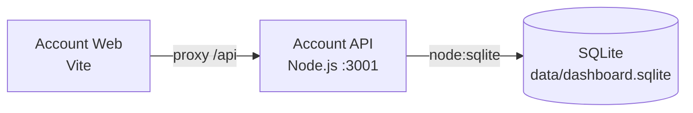

# Azure Debug Plan

> This plan is the source of truth for generating the
> VS Code debug setup in this workspace.
>
> **Status:** Implemented
> **Execution Mode:** Guided
> **Created:** 2026-10-02T00:00:00Z
> **Last Updated:** 2026-10-11
>
> <!-- Guided Mode requires user review and approval before generation. -->

---

## Prerequisites

| Tool / Extension | Category | Service(s) | Installed | Version |
|------------------|----------|------------|-----------|---------|
| Node.js | Runtime | * | ✅ | 24.19.0 |
| npm | Package manager | * | ✅ | 11.17.0 (`npm.cmd`; PowerShell blocks `npm.ps1`) |
| Vite | Run tooling | Account Web | ✅ | 7.3.6 |
| VS Code JavaScript debugger (`ms-vscode.js-debug`) | Debug extension | Account Web, Account API | ❓ | — |
| Google Chrome | Browser | Account Web | ✅ | 154.0.8037.98 |

> ⚠️ **Action required:** Confirm the JavaScript debugger integration is available. In PowerShell, use `npm.cmd` because the current execution policy blocks `npm.ps1`.

---

## Debug Configurations

| Generate | Debug Config Name | Service Label | Service Root | Project Type | Runtime | Version | Azure Dependencies |
|----------|--------------------|---------------|--------------|--------------|---------|---------|---------------------|
| [ ] | Account API (debug) | Account API | ./backend | app-service | node-js | 24.19.0 | — |
| [ ] | Account Web (debug) | Account Web | ./ | frontend-spa | node-ts | 24.19.0 | — |
| [ ] | Debug All Services | Debug All Services | | *Compound Config* | | | |

ℹ️ Project Type Descriptions

| Project Type | Description |
|-------------|-------------|
| app-service | Node.js HTTP API server launched from the backend entry point. |
| frontend-spa | React single-page application served by Vite. |

> ℹ️ **Proxy detected:** Account Web proxies `/api` to Account API at `http://127.0.0.1:3001` via `vite.config.ts`. The compound configuration should start the API before the frontend. The backend service ID is `backend`.

---

## Orchestrator

| Orchestrator | Container Runtime | Compose Command | Description |
|-------------|-------------------|-----------------|-------------|
| Not required | — | — | The locally debugged services have no Azure emulator dependencies, so containers are not needed. |

---

## Emulators

| Dependent Service | Emulator | Purpose |
|-------------------|----------|---------|
| — | None | The API uses the built-in `node:sqlite` module and a local SQLite file; no Azure services or emulators were detected. |

---

## Architecture Diagram

Vite serves the React frontend and proxies API requests to the Node.js service, which persists application data in a local SQLite file.

---

## Migrations

The checked migration task applies the project's ordered SQLite SQL migrations before debugging. The existing `npm run migrate` script is the migration command; rollback remains available through `npm run migrate:rollback`.

| Generate | Service | Migration Tool |
|----------|---------|----------------|
| [x] | Account API | Raw SQL (SQLite), `npm run migrate` (23 ordered migrations) |

---

## API Test Collections

The listed routes have existing PowerShell collection scripts. The backend also registers routes not covered by these collections, including `GET /api/public/countries`, `POST /api/presence`, and administrative country, promoter, live-user, summary, and platform-settings routes. Confirm whether those routes should receive smoke-test scripts before approval.

| Generate | Service | Description |
|----------|---------|-------------|
| [x] | Account API | 

HTTP Endpoints
 GET /api/health POST /api/auth/register POST /api/auth/login POST /api/auth/logout GET /api/auth/me GET /api/dashboard GET /api/user/account-state GET /api/user/messages PATCH /api/user/messages/:id/read GET /api/wallet/products GET /api/wallet/daily-checkin POST /api/wallet/daily-checkin GET /api/wallet/balance GET /api/wallet/withdraw/account PUT /api/wallet/withdraw/account GET /api/wallet/transactions GET /api/wallet/deposit/methods GET /api/wallet/withdraw/methods POST /api/wallet/deposit POST /api/wallet/withdraw/preview POST /api/wallet/withdraw GET /api/deposit-methods GET /api/team POST /api/purchases GET /api/support/settings GET /api/support/conversations POST /api/support/conversations GET /api/support/conversations/:id/messages POST /api/support/conversations/:id/messages GET /api/admin/daily-checkin PUT /api/admin/daily-checkin PUT /api/admin/members/role GET /api/admin/overview GET /api/admin/members GET /api/admin/users GET /api/admin/users/:id PATCH /api/admin/users/:id DELETE /api/admin/users/:id POST /api/admin/users/:id/reset-password POST /api/admin/messages/private POST /api/admin/messages/broadcast GET /api/admin/plans POST /api/admin/plans PUT /api/admin/plans/:name DELETE /api/admin/plans/:name GET /api/admin/support/settings PUT /api/admin/support/settings GET /api/admin/audit-log GET /api/admin/deposit-methods POST /api/admin/deposit-methods PUT /api/admin/deposit-methods/:code DELETE /api/admin/deposit-methods/:code GET /api/admin/referral-settings POST /api/admin/referral-settings GET /api/admin/payment-methods POST /api/admin/payment-methods GET /api/admin/support/conversations GET /api/admin/purchases POST /api/admin/purchases/:id/approve GET /api/admin/transactions GET /api/admin/transactions/:id/proof POST /api/admin/transactions/:id/approve POST /api/admin/transactions/:id/reject  
API tests are implemented under `backend/tests/` (`auth.test.mjs`, `deposit-methods.test.mjs`, and `user-management.test.mjs`) and run with `npm run test:api`. |

---

## Convenience Scripts

| Generate | Script | Registered In | Description |
|----------|--------|---------------|-------------|
| [ ] | dev | ./package.json | Existing Vite frontend script; do not duplicate. |
| [ ] | api | ./package.json | Existing Node API script; do not duplicate. |
| [ ] | migrate | ./package.json | Existing SQLite migration script; do not duplicate. |
| [ ] | test:api | ./package.json | Existing Node API test script; do not duplicate. |

## Generated API Test Collections

Windows PowerShell invokers are in `api-test-collections/account-api/`; shared request options are documented in that directory's `README.md`. Set `API_COOKIE` for a session, `ADMIN_API_TOKEN` for bootstrap-token routes, `API_TEST_BODY` for JSON request bodies, and `API_TEST_ID`, `API_TEST_NAME`, or `API_TEST_CODE` for dynamic path segments.

> 🔒 = requires an authenticated session or the bootstrap admin token, depending on the route.

### GET /api/health `http-health`
### POST /api/auth/register `http-register`
### POST /api/auth/login `http-login`
### POST /api/auth/logout `http-logout`
### GET /api/auth/me `http-me`
### GET /api/dashboard 🔒 `http-dashboard`
### GET /api/user/account-state 🔒 `http-account-state`
### GET /api/user/messages 🔒 `http-user-messages`
### PATCH /api/user/messages/:id/read 🔒 `http-message-read`
### GET /api/wallet/products 🔒 `http-products`
### GET /api/wallet/daily-checkin 🔒 `http-daily-checkin-get`
### POST /api/wallet/daily-checkin 🔒 `http-daily-checkin-claim`
### GET /api/wallet/balance 🔒 `http-balance`
### GET /api/wallet/withdraw/account 🔒 `http-withdrawal-account-get`
### PUT /api/wallet/withdraw/account 🔒 `http-withdrawal-account-put`
### GET /api/wallet/transactions 🔒 `http-wallet-transactions`
### GET /api/wallet/deposit/methods 🔒 `http-deposit-methods`
### GET /api/wallet/withdraw/methods 🔒 `http-withdraw-methods`
### POST /api/wallet/deposit 🔒 `http-deposit`
### POST /api/wallet/withdraw/preview 🔒 `http-withdraw-preview`
### POST /api/wallet/withdraw 🔒 `http-withdraw`
### GET /api/deposit-methods 🔒 `http-public-deposit-methods`
### GET /api/team 🔒 `http-team`
### POST /api/purchases 🔒 `http-purchases`
### GET /api/support/settings 🔒 `http-support-settings`
### GET /api/support/conversations 🔒 `http-conversations-get`
### POST /api/support/conversations 🔒 `http-conversations-create`
### GET /api/support/conversations/:id/messages 🔒 `http-conversation-messages-get`
### POST /api/support/conversations/:id/messages 🔒 `http-conversation-messages-create`
### GET /api/admin/daily-checkin 🔒 `http-admin-daily-checkin-get`
### PUT /api/admin/daily-checkin 🔒 `http-admin-daily-checkin-put`
### PUT /api/admin/members/role 🔒 `http-admin-members-role`
### GET /api/admin/overview 🔒 `http-admin-overview`
### GET /api/admin/members 🔒 `http-admin-members`
### GET /api/admin/users 🔒 `http-admin-users`
### GET /api/admin/users/:id 🔒 `http-admin-user-get`
### PATCH /api/admin/users/:id 🔒 `http-admin-user-patch`
### DELETE /api/admin/users/:id 🔒 `http-admin-user-delete`
### POST /api/admin/users/:id/reset-password 🔒 `http-admin-user-reset-password`
### POST /api/admin/messages/private 🔒 `http-admin-message-private`
### POST /api/admin/messages/broadcast 🔒 `http-admin-message-broadcast`
### GET /api/admin/plans 🔒 `http-admin-plans-get`
### POST /api/admin/plans 🔒 `http-admin-plans-post`
### PUT /api/admin/plans/:name 🔒 `http-admin-plan-put`
### DELETE /api/admin/plans/:name 🔒 `http-admin-plan-delete`
### GET /api/admin/support/settings 🔒 `http-admin-support-settings-get`
### PUT /api/admin/support/settings 🔒 `http-admin-support-settings-put`
### GET /api/admin/audit-log 🔒 `http-admin-audit-log`
### GET /api/admin/deposit-methods 🔒 `http-admin-deposit-methods-get`
### POST /api/admin/deposit-methods 🔒 `http-admin-deposit-methods-post`
### PUT /api/admin/deposit-methods/:code 🔒 `http-admin-deposit-method-put`
### DELETE /api/admin/deposit-methods/:code 🔒 `http-admin-deposit-method-delete`
### GET /api/admin/referral-settings 🔒 `http-admin-referral-settings-get`
### POST /api/admin/referral-settings 🔒 `http-admin-referral-settings-post`
### GET /api/admin/payment-methods 🔒 `http-admin-payment-methods-get`
### POST /api/admin/payment-methods 🔒 `http-admin-payment-methods-post`
### GET /api/admin/support/conversations 🔒 `http-admin-support-conversations`
### GET /api/admin/purchases 🔒 `http-admin-purchases`
### POST /api/admin/purchases/:id/approve 🔒 `http-admin-purchase-approve`
### GET /api/admin/transactions 🔒 `http-admin-transactions`
### GET /api/admin/transactions/:id/proof 🔒 `http-admin-transaction-proof`
### POST /api/admin/transactions/:id/approve 🔒 `http-admin-transaction-approve`
### POST /api/admin/transactions/:id/reject 🔒 `http-admin-transaction-reject`

## Debug Configuration Checklist

✅ Account API (debug) — `Debugger listening` and API listening signals observed; `/api/health` returned HTTP 200; Node inspector `/json/version` returned HTTP 200.
✅ Account Web (debug) — Vite ready and `Local:` signals observed; `http://127.0.0.1:5173/` returned HTTP 200.
✅ Debug All Services — sequenced API then web startup started each service once; API health and web returned HTTP 200; Vite `/api/health` proxy returned HTTP 200 with API JSON.

The latest workspace context reports the Account API and Account Web tasks are currently running, so ports 3001, 5173, 9229, and 9230 must not be assumed free. The workspace SQLite database remains at `data/dashboard.sqlite`.